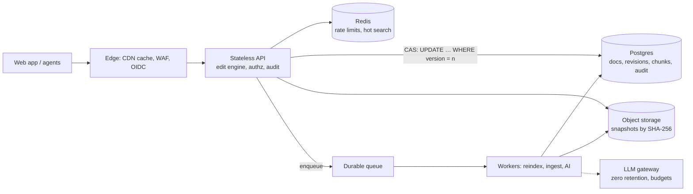

# CLAUSE — Production Design (Part II)

**Goal:** a multi-tenant, auditable service for legal teams, without paying for complexity before it's earned. The correctness core (edit engine + version compare-and-swap) is already the right shape; production changes the storage and operations around it.

**Assumptions (mine):** contract ≤ 1 MB typical, 25 MB tail · hundreds of tenants, ≤ 50 concurrent editors each · reads ≫ writes · 99.9% availability · privileged material · US + EU customers.

## What changes from the prototype

| Area | Prototype (measured) | Production | Trade-off |
|---|---|---|---|
| **Storage** | SQLite, full snapshot per revision (10 MB doc ≈ 10 MB/edit) | Postgres for metadata + current text ≤ 1 MB; snapshots in object storage keyed by the SHA-256 we already compute; a full one every ~20 revisions + deltas | Restore replays ≤ 20 deltas |
| **Search** | FTS5 words + trigram | `tsvector` GIN + `pg_trgm` GIN, **indexed per paragraph chunk with a start offset** | `tsvector` caps near 1 MB and whole-row `snippet()` is O(matches) (8.3 s on 10 MB); chunks fix both |
| **Index freshness** | Same transaction | Same transaction up to a size threshold, then an outbox + worker; responses carry `indexedVersion` so the UI says "indexing v7→v8" | Bounded staleness, huge docs only |
| **Concurrency** | Version CAS + `If-Match` | Same SQL, plus `Idempotency-Key` so a retry after a timeout can't double-apply | No auto-merge, ever |
| **Large payloads** | PATCH returns full text | Receipt + `contentUrl` above ~1 MB (Vercel Functions cap bodies at 4.5 MB) | One extra round-trip |
| **AI suggestions** | Optional, never applies | Async job pinned to a version, same engine validates, per-tenant budget | A proposal can go stale; it re-validates on accept |

## Compute, caching, batching
- **Compute:** stateless API replicas (min 2, across AZs) autoscale on p95 latency and CPU; workers on queue age.
- **Caching:** a version is immutable, so reads cache by `(id, version/ETag)`. The API already answers `If-None-Match` with `304`, which the edge serves. Redis holds only rate-limit counters and hot search pages keyed by `(query, indexedVersion)`, never shared across tenants. Invalidation is free (an edit is a new version, so the key changes); the cost is a stale page until `indexedVersion` moves.
- **Batching:** the PATCH batch is the atomic unit and is capped (5,000 changes now); reindex and ingest are batched on workers, off the request path.

## Security & compliance
- **AuthN/Z:** SSO (OIDC/SAML) + SCIM, short-lived JWTs, RBAC per workspace/matter. **Tenant isolation in the database:** `tenant_id` on every table plus Postgres row-level security, so a forgotten `WHERE` fails closed.
- **Encryption:** TLS 1.2+, KMS at rest, **per-tenant data keys** (crypto-shredding for erasure).
- **Audit:** append-only log of who, what, version, before/after hashes (never the text), shipped to WORM storage; the edit receipt already carries the evidence.
- **SOC 2 / GDPR** are controls and evidence, not an architecture. The design supports them (per-tenant retention, erasure via key shredding, EU data in an EU cell, a sub-processor list that includes the LLM provider); I wouldn't claim either until audited.

## Scale, resilience, delivery
- **Scale path (measure first):** replicas → read replica for search → partition `revisions`/`chunks` by tenant → then a search cluster. Edit time is index maintenance and transfer, not the engine (7 ms of ~713 ms on 10 MB), so first comes incremental chunk indexing. Measured on the prototype (1 MB docs, one process, SQLite): one client's edit p95 is 61 ms, but throughput plateaus near 19 edits/s because writes serialise, so 8 concurrent writers see p95 879 ms and miss the 500 ms target. The SLOs above are for this Postgres design and are untested.
- **Failover:** Multi-AZ Postgres with automatic failover (targets: RPO ≈ 0 in region, RTO minutes); PITR with a scheduled restore drill; warm DR region (RPO ≤ 5 min target). Consumers are idempotent with retry + DLQ.
- **CI/CD:** per-PR previews → typecheck, unit + property tests, API tests on an ephemeral DB, migration check (expand → migrate → contract); scheduled mutation and OpenAPI-fuzz runs (both scripted here). Progressive rollout, one-click rollback.
- **Multi-region:** single-writer primary, **cells per region** for residency. No active-active writes: the CAS needs one writer per document; CRDT collaboration would change that, a product decision, not a refactor.

## Observability & cost
- **Metrics:** edit and search latency by document-size bucket · **conflict rate** (a spike means a UX or retry bug) · index lag · queue age · AI cost per tenant. **SLOs:** edit p95 < 500 ms (≤ 1 MB), search p95 < 300 ms. Traces and logs carry IDs and hashes, never text.
- **Alerts:** *page* on SLO burn (edit p95 over 500 ms for 5 min), 5xx over 1%, queue age over 5 min, replica lag, a conflict spike. *Ticket:* index lag, storage growth, AI spend.
- **Cost:** cap document and batch size, right-size from p95. Unit metrics: **$ per 1k edits**, **$ per GB-month of revisions**.
