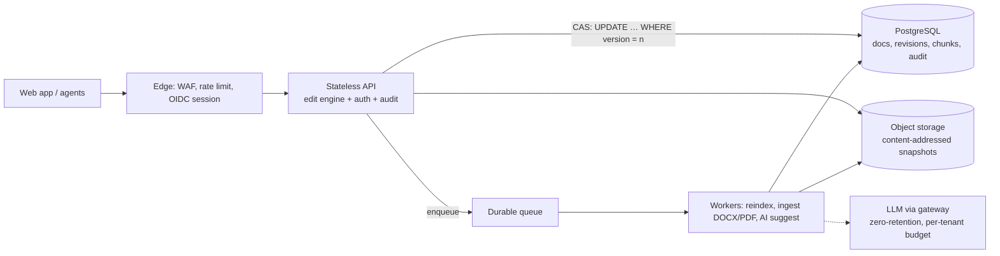

# CLAUSE — Production Design (Part II)

**Goal:** turn the take-home into a multi-tenant, auditable service for legal teams without paying for complexity before it's earned.
**Principle:** the correctness boundary (edit engine + version CAS) is already the right shape; production changes the *storage and operations around it*, not the engine.

**Assumptions (mine, not customer facts — each one changes a decision below):**
typical contract ≤ 1 MB, tail to 25 MB · hundreds of tenants, ≤ 50 concurrent editors per tenant · reads ≫ writes · search ≈ 10× edits ·
availability 99.9% · documents are confidential (privileged material) · US + EU customers.

## What changes from the prototype, and why

| Area | Prototype (measured) | Production | Trade-off I'm accepting |
|---|---|---|---|
| **Storage** | SQLite; full snapshot per revision (a 10 MB doc ≈ 10 MB/edit) | Postgres for metadata + current text ≤ 1 MB; **snapshots in object storage keyed by the SHA-256 we already compute** (dedupes, immutable, cheap). Keep a full snapshot every ~20 revisions + reverse deltas between. | Restore of an old version = fetch + replay ≤ 20 deltas. Simpler: always full snapshots, accept the storage bill. |
| **Search** | FTS5: `porter` words index + `trigram` exact index | Postgres `tsvector` (GIN) for words, `pg_trgm` (GIN) for exact. **Index chunks (paragraph/clause rows with a start offset), not whole documents.** | Chunking is needed anyway: a `tsvector` is capped at ~1 MB, and the prototype showed whole-row `snippet()` is O(matches) (8.3 s on 10 MB). Chunks make snippets cheap and give clause-level hits and offsets for free. Cost: re-chunking on edit (only touched chunks, via the receipt's spans). |
| **Search consistency** | Index updated by trigger in the same transaction | Same transaction up to a size threshold; above it, an **outbox + worker** reindexes asynchronously. Search responses carry `indexedVersion`; the UI shows "indexing v7→v8" instead of silently serving stale hits. | Bounded staleness for huge docs only. Never silently stale. |
| **Concurrency** | Version CAS + `If-Match` | Identical SQL. Add `Idempotency-Key` (24 h) so retries after a timeout don't double-apply — *a different problem from conflicts*. Conflict → 409 with current version; the client revalidates. | No auto-merge, ever. Rebase UX is a product decision, not a storage one. |
| **Large payloads** | PATCH returns full text (assessment requirement) | Return the receipt + `contentUrl` above ~1 MB (or when `Accept-Content: omit`). **If hosted on Vercel Functions, request/response bodies are capped at 4.5 MB**, so ≥ 10 MB documents upload/download directly to blob storage and the function only handles metadata and edits. | One extra round-trip for big docs. |
| **AI suggestions** | Optional route; never applies | Async job (queue) pinned to a document version; result is a *proposal* validated by the same engine; per-tenant token budget; provider behind the AI Gateway for fallback + zero data retention. | Suggestions can go stale mid-flight — by design they re-validate against the then-current version at accept time. |

## Security & compliance
- **AuthN/Z:** SSO via OIDC/SAML + SCIM; short-lived JWTs; RBAC per workspace/matter. **Tenant isolation at the database**: `tenant_id` on every table and Postgres **row-level security**, plus tenant in every index prefix — a missing `WHERE` must fail closed.
- **Encryption:** TLS 1.2+; at rest via the cloud KMS; **envelope encryption with per-tenant data keys** (enables crypto-shredding for erasure and customer-managed keys later).
- **Audit:** append-only `audit_log` (who, tenant, doc, version, before/after hash — *never the text*), shipped to WORM storage. The edit receipt (`beforeHash`/`afterHash`) already carries the evidence.
- **SOC 2 / GDPR:** these are *controls and evidence*, not an architecture. Design supports them: retention policies per tenant, erasure that covers revisions + chunks + object snapshots + backups (via key shredding), EU data in an EU region cell, DPA + sub-processor list (incl. the LLM provider). I wouldn't claim either until audited.
- **Hardening:** per-tenant rate limits and body caps, no document text in logs/traces, secrets in a manager, dependency + SAST in CI.

## Scale, resilience, delivery
- **Scale path (measure first):** stateless API replicas → Postgres read replica for search → partition `revisions`/`chunks` by tenant → *only then* a dedicated search cluster. Edit latency is dominated by index maintenance, not the engine (3 ms of ~800 ms for a 10 MB edit in the prototype), so the first optimisation is incremental chunk indexing, not a faster algorithm.
- **Caching:** `ETag`/`304` already in place; small in-process LRU of current text keyed by `contentHash`. No Redis until a profile asks for it.
- **Resilience:** managed Postgres Multi-AZ failover; PITR backups + a **scheduled restore drill** (an untested backup is a hope); queue consumers idempotent with retry + DLQ; health checks gate rollout.
- **CI/CD:** per-PR **preview deployments** → typecheck, unit + property tests, API tests on an ephemeral DB, migration check (**expand → migrate → contract**, no breaking deploys), mutation + OpenAPI fuzz on a schedule. Release with a **flag + progressive rollout** and one-click rollback; DB changes stay backward-compatible for one release.
- **Multi-region:** single-writer regional primary with a warm DR region; **cells per region** for residency. Active-active writes are deliberately out: version-CAS needs one linearizable writer per document.

## Observability & cost
- **Metrics (RED + domain):** p50/95/99 edit & search latency by document-size bucket · **conflict rate** (a spike = a UX or retry bug) · ambiguity/validation-reject rate · index lag (versions behind) · queue depth/age · DB lock waits & table growth · AI latency/cost per tenant.
- **Tracing/logs:** OpenTelemetry with request IDs; document IDs and hashes only. **SLOs:** edit p95 < 500 ms (≤ 1 MB), search p95 < 300 ms, 99.9% success.
- **Cost controls:** cap document size (e.g. 25 MB) and batch size; snapshot/delta policy + object lifecycle tiers; right-size from p95 not peak; per-tenant AI budgets with alerts; unit metric = **$ per 1k edits** and **$ per GB-month of revisions**.

## Decisions I'd defend, and what I'd revisit
1. **Postgres before Elasticsearch** — until measured relevance or load says otherwise; one transaction beats an eventually-consistent second system for legal text.
2. **Objects for big/immutable bytes, rows for the truth** — hashes tie them together and make audit cheap.
3. **Revisit** chunk indexing granularity, delta-vs-snapshot threshold, and whether collaborative editing (CRDT) is ever needed — it would replace version-CAS with a different consistency model, so it's a product call, not a refactor.
