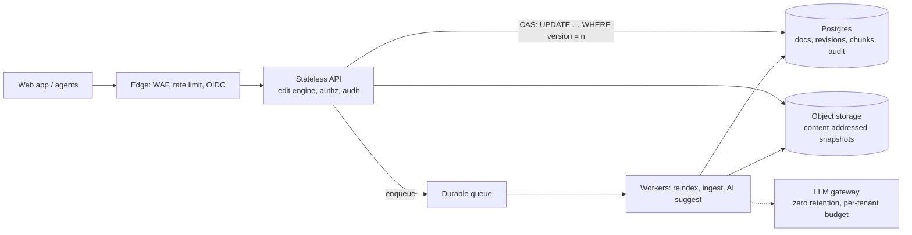

# CLAUSE — Production Design (Part II)

**Goal:** a multi-tenant, auditable service for legal teams, without paying for complexity before it's earned. The correctness core (edit engine + version compare-and-swap) is already the right shape; production changes the *storage and operations around it*.

**Assumptions (mine, not customer facts):** typical contract ≤ 1 MB, tail to 25 MB · hundreds of tenants, ≤ 50 concurrent editors each · reads ≫ writes, search ≈ 10× edits · 99.9% availability · privileged material · US + EU customers.

## What changes from the prototype

| Area | Prototype (measured) | Production | Trade-off |
|---|---|---|---|
| **Storage** | SQLite; a full snapshot per revision (10 MB doc ≈ 10 MB/edit) | Postgres for metadata + current text ≤ 1 MB; **snapshots in object storage keyed by the SHA-256 we already compute**; full snapshot every ~20 revisions + deltas between | Restore = fetch + replay ≤ 20 deltas |
| **Search** | FTS5: stemmed words + trigram | `tsvector` GIN (words) + `pg_trgm` GIN (exact), **indexed per paragraph/clause chunk with a start offset** | A `tsvector` caps near 1 MB, and the prototype showed whole-row `snippet()` is O(matches) (8.3 s on 10 MB). Chunks fix both and give clause-level hits; edits re-chunk only touched spans (the receipt lists them) |
| **Index consistency** | Triggers, same transaction | Same transaction up to a size threshold; above it an **outbox + worker**. Search responses carry `indexedVersion`, so the UI says "indexing v7→v8" rather than serving silently stale hits | Bounded staleness for huge docs only |
| **Concurrency** | Version CAS + `If-Match` | Same SQL, plus `Idempotency-Key` so a retry after a timeout can't double-apply (a different problem from conflicts) | No auto-merge, ever |
| **Large payloads** | PATCH returns the full text | Return the receipt + `contentUrl` above ~1 MB. **If hosted on Vercel Functions, bodies are capped at 4.5 MB**, so big documents go straight to blob storage and the function handles only metadata and edits | One extra round-trip |
| **AI suggestions** | Optional route, never applies | Async job pinned to a document version, validated by the same engine; per-tenant budget, gateway for fallback and zero retention | A proposal can go stale; it re-validates at accept time |

## Security & compliance
- **AuthN/Z:** SSO (OIDC/SAML) + SCIM, short-lived JWTs, RBAC per workspace/matter. **Tenant isolation in the database:** `tenant_id` on every table plus Postgres **row-level security**, so a forgotten `WHERE` fails closed.
- **Encryption:** TLS 1.2+, KMS at rest, **per-tenant data keys** (enables crypto-shredding for erasure, customer-managed keys later).
- **Audit:** append-only log of who, what, version, and before/after hashes (**never the text**), shipped to WORM storage. The edit receipt already carries the evidence.
- **SOC 2 / GDPR** are *controls and evidence*, not an architecture. The design supports them (per-tenant retention, erasure across revisions + chunks + snapshots + backups via key shredding, EU data in an EU cell, DPA and sub-processor list including the LLM provider). I wouldn't claim either until audited.

## Scale, resilience, delivery
- **Scale path (measure first):** stateless replicas → read replica for search → partition `revisions`/`chunks` by tenant → *then* a search cluster. Edit latency is index maintenance, not the engine (7 ms of ~713 ms for a 10 MB edit), so the first optimisation is incremental chunk indexing, not a faster algorithm.
- **Resilience:** managed Postgres Multi-AZ, PITR backups with a **scheduled restore drill**, idempotent queue consumers with retry + DLQ, health checks gating rollout.
- **CI/CD:** per-PR preview deployments → typecheck, unit + property tests, API tests on an ephemeral DB, migration check (**expand → migrate → contract**); scheduled mutation + OpenAPI-fuzz runs (both already scripted here). Flag + progressive rollout + one-click rollback.
- **Multi-region:** single-writer primary + warm DR, **cells per region** for residency. No active-active writes: version-CAS needs one writer per document. CRDT collaboration would change that consistency model, so it's a product decision, not a refactor.

## Observability & cost
- **Metrics:** p50/95/99 edit and search latency by document-size bucket · **conflict rate** (a spike means a UX or retry bug) · ambiguity/validation-reject rate · index lag · queue age · DB lock waits and growth · AI latency and cost per tenant. **SLOs:** edit p95 < 500 ms (≤ 1 MB), search p95 < 300 ms. Traces and logs carry IDs and hashes, never document text.
- **Cost:** cap document and batch size; snapshot/delta policy plus object lifecycle tiers; right-size from p95; per-tenant AI budgets. Unit metrics: **$ per 1k edits**, **$ per GB-month of revisions**.
