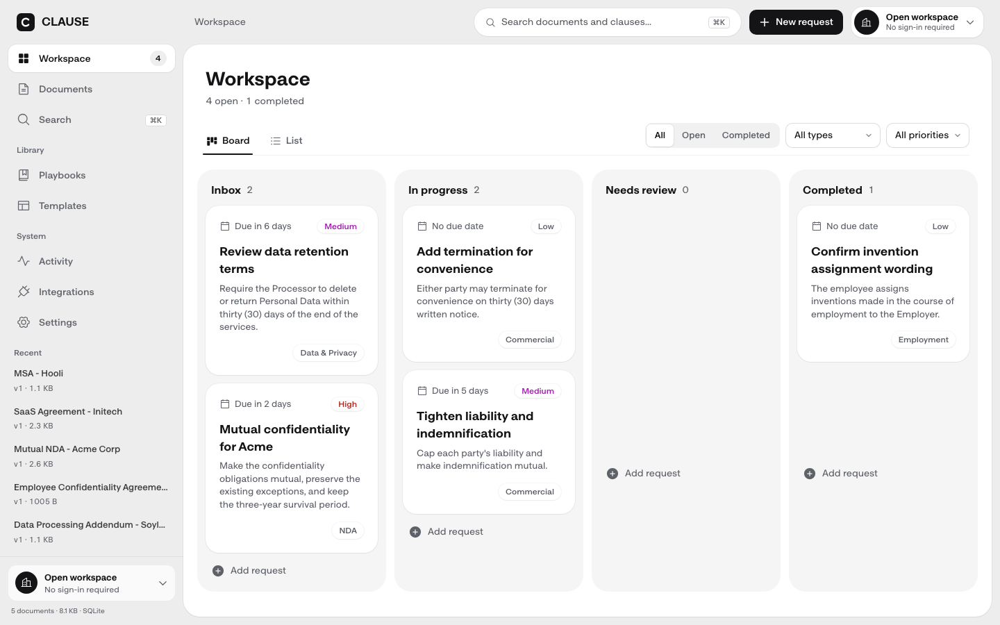
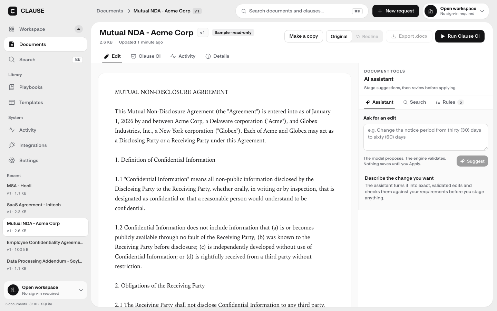

# clause

[](https://github.com/olanotolu/clause-take-home/actions/workflows/ci.yml)

**a redlining and search service for contracts.** point at exact text, stage changes, preview the redline, and apply them as a new version. search returns passages you can edit from. when a request is ambiguous, overlaps another change or was made against an old version, clause returns a precise error instead of guessing.

| open | what you'll see |
|---|---|
| **[live demo](https://clause-take-home.vercel.app/#/documents)** | public Vercel URL; the page is currently not ready because its database readiness check returns 503 (checked October 19, 2026). The local seeded app below is usable while the hosted database is restored |
| **[walkthrough video (9:46)](https://clause-take-home.vercel.app/video)** | narrated tour with chapters, captions and a transcript; recorded october 19 against `c04a163`, on a local copy of the app; the narration is a synthetic voice cloned from the author |
| **[api reference](https://clause-take-home.vercel.app/api/docs/)** | interactive openapi reference, generated from the same schemas that validate requests |
| **full assessment submission (pdf)** | detailed take-home response, infrastructure design, implementation evidence, limitations, and live discussion guide; saved on the submitter's Desktop and kept outside this repository |
| **[editable assessment source](docs/ASSESSMENT_SUBMISSION.md)** | the markdown source used to produce the submission pdf |
| **[production design](INFRA.md)** | part ii, one page: measured numbers against targets, decisions by topic, risks |
| **[one-page pdf](output/pdf/CLAUSE-infrastructure.pdf)** | the same production design as a pdf |
| **[operations](docs/OPERATIONS.md)** | how it runs: durable jobs, migrations and recovery, telemetry, the rollout gate |
| **[performance audit](docs/INFRA_PERFORMANCE_AUDIT_2026_10_18.md)** | dated infrastructure findings and the follow-up verification status |
| **[scope map](ASSESSMENT_SCOPE.md)** | each item in the brief mapped to the code and test that answer it; extras labelled |

## product screenshots

Two desktop captures from the current app, showing the fictional workspace and contract editor.

<p align="center">
  
  
</p>

The screenshots are product views, not benchmark evidence. Performance measurements and their environment are documented in [performance](#performance) and the [dated reports](bench/performance/results/).

> the demo is a shared workspace with fictional contracts and no sign-in. the five sample contracts are read-only: use **make a copy** to edit one. don't put real contracts in it.

**on this page:** [screenshots](#product-screenshots) · [where to look](#where-to-look) · [run it](#run-it) · [brief → implementation](#what-was-asked-and-where-it-is) · [api](#the-api-at-a-glance) · [design decisions](#design-decisions-and-trade-offs) · [performance](#performance) · [tests](#how-its-tested) · [clause ci and ai](#clause-ci-and-ai-suggestions) · [production](#production-design-part-ii) · [limits](#limits) · [repo map](#repository-map)

---

## where to look

| if you want to see… | open |
|---|---|
| how an edit is resolved and applied | [`packages/core/src/resolve.ts`](packages/core/src/resolve.ts), [`apply.ts`](packages/core/src/apply.ts): pure typescript, zero dependencies |
| how a write stays safe when two people edit | `commitRevision` in [`apps/api/src/store/sqlite.ts`](apps/api/src/store/sqlite.ts), and [`apps/api/test/concurrency.test.ts`](apps/api/test/concurrency.test.ts) |
| the api contract | [`apps/api/src/schemas.ts`](apps/api/src/schemas.ts) (validation and openapi from one source), [`errors.ts`](apps/api/src/errors.ts), [`routes/documents.ts`](apps/api/src/routes/documents.ts) |
| search | [`apps/api/src/search.ts`](apps/api/src/search.ts), and the postgres chunk query in [`store/word-search-sql.ts`](apps/api/src/store/word-search-sql.ts) |
| large documents | [`content-storage.ts`](apps/api/src/content-storage.ts) (bodies by hash in blob or on disk), [`routes/documents.ts`](apps/api/src/routes/documents.ts) (upload intents) |
| slow work | [`apps/api/src/jobs`](apps/api/src/jobs), [`apps/api/workflows`](apps/api/workflows): exports, imports and maintenance as durable jobs |
| the tests | [`packages/core/test`](packages/core/test), [`apps/api/test`](apps/api/test), [`e2e/journeys.spec.ts`](e2e/journeys.spec.ts) |
| part ii | [`INFRA.md`](INFRA.md) (one page), with a longer [appendix](docs/INFRA_APPENDIX.md); running it: [`docs/OPERATIONS.md`](docs/OPERATIONS.md) |
| what is core and what is extra | [`ASSESSMENT_SCOPE.md`](ASSESSMENT_SCOPE.md) |
| what went wrong along the way | [`NOTES.md`](NOTES.md): every real bug, how it was found, what changed |

---

## synthetic insurance review demo

Open `http://localhost:5173/#/insurance` after `pnpm install --frozen-lockfile` and `pnpm dev:web`. This browser-session fixture needs no database or AI key; **Reset demo** resets only the case. See [the walkthrough and limitations](docs/sequence-demo.md). Use fictional data only.

## run it

node 24.x and pnpm 10.33.0. there's no database server, no docker and no api key required.

```sh
pnpm install --frozen-lockfile
pnpm seed                 # five fictional contracts into a local sqlite file
pnpm dev                  # api on :3000, interactive openapi reference at /docs
pnpm dev:web              # ui on :5173, proxies /api to the api
./http/demo.sh            # curl walkthrough of the api (needs jq)
```

optional, in `.env.local` (copy `.env.example`): `OPENROUTER_API_KEY` turns on ai suggestions and the current semantic judge. `TYPESAFE_API_KEY` plus `CLAUSE_JEV_MODE=shadow` enables Jev 1.14 shadow evaluation for semantic checks; the current judge remains authoritative. Jev sends document text and requirements to TypeSafe AI, so use fictional or non-confidential documents in the shared unauthenticated demo. Pilot mode additionally requires the frozen benchmark gate (`CLAUSE_JEV_PILOT_GATE=passed`). `CLAUSE_STORAGE=postgres` with `DATABASE_URL` runs on postgres. without AI keys, editing, search and exact checks still work.

the api runs typescript directly under node's type stripping, so type checking is its own gate:

```sh
pnpm typecheck && pnpm lint && pnpm test:coverage
CLAUSE_TEST_DATABASE_URL=postgresql://… pnpm test:coverage   # the same suite on postgres (disposable database)
pnpm test:e2e             # real browser, desktop and 390 px phone, with accessibility checks
pnpm bench                # 10 mib benchmark;  pnpm load  for the concurrency check
```

---

## what was asked, and where it is

the brief, in my own words, with the part of the repo that answers each item.

| asked for | how clause does it | evidence |
|---|---|---|
| **edit a document** with a json change request and get the updated text back | `PATCH /documents/:id` with a `changes` array; each change targets a quote (with occurrence, prefix or suffix) or a position (with the text expected there). the response is a receipt with the full new text | [`packages/core/test`](packages/core/test), [`documents.test.ts`](apps/api/test/documents.test.ts) |
| **search** one or many documents for matching context | `GET /documents/search` and `GET /documents/:id/search`: ranked word search and literal exact search, with snippets and offsets you can edit from | [`search.test.ts`](apps/api/test/search.test.ts) |
| **tests** for change and search logic, including large files | unit, property and api tests on sqlite and postgres; a 10 mib benchmark; a load check | [how it's tested](#how-its-tested), [`bench/performance`](bench/performance/README.md) |
| **sample requests** | [`http/demo.sh`](http/demo.sh) (curl), plus the [openapi reference](https://clause-take-home.vercel.app/api/docs/) | |
| **readme** with setup, usage, performance and api rationale | this file | |
| correct **4xx/5xx** with a json `{ error, code }` body | one error shape for every response, including framework errors; a 500 never leaks a stack or document text | a forced-500 test, the weekly api fuzz |
| **bulk** changes | `changes` is an array of up to 5,000, applied all-or-nothing | `engine.test.ts`, `documents.test.ts` |
| **large documents**, near-linear | the new text is rebuilt in one pass; 7 ms for one edit on 10 mib. targets in large batches are found in one pass too (aho–corasick): 5,000 quote changes on 10 mib resolve in about 100 ms. documents go up to 25 mib: bodies above 1 mib travel through direct uploads and signed urls, so api responses stay small | [performance](#performance), [`large-documents.test.ts`](apps/api/test/large-documents.test.ts) |
| **concurrency** and repeated matches | `expectedVersion` or `If-Match`, then a compare-and-swap commit: a stale write gets 409 or 412. a quote that matches more than once is refused with every candidate listed | [`concurrency.test.ts`](apps/api/test/concurrency.test.ts), [`etag-race.test.ts`](apps/api/test/etag-race.test.ts) |
| **indexing**, and its trade-offs | inverted indexes inside the database (sqlite fts5 and trigram; postgres gin over 8,000-character chunks, and pg_trgm), updated in the same transaction as the edit | [why not an in-memory inverted index](#why-not-an-in-memory-inverted-index) |
| **api design** rationale | resources for reads and writes, named actions where an action isn't a resource update | [design decisions](#design-decisions-and-trade-offs) |
| **part ii**: production design | [`INFRA.md`](INFRA.md): measured numbers against targets, a decision table by topic, the risks | [pdf](output/pdf/CLAUSE-infrastructure.pdf) |

built beyond the brief, and labelled as extras in [`ASSESSMENT_SCOPE.md`](ASSESSMENT_SCOPE.md): clause ci, ai suggestions, word tracked-changes export, the workspace ui (requests, playbooks, templates), the integrations demo, durable background jobs, metrics over opentelemetry, and the walkthrough video.

---

## the api at a glance

| method and path | what it does |
|---|---|
| `POST /documents` | create (201, `Location`, `ETag`) |
| `GET /documents` · `GET /documents/:id` | list (paged) · read; `If-None-Match` gives 304 |
| `PATCH /documents/:id` | apply a batch of changes; returns a receipt |
| `POST /documents/:id/changes/preview` | dry run through the same engine call; writes nothing |
| `POST /documents/:id/changes/check` | clause ci: check a proposed edit against saved requirements |
| `POST /documents/:id/revert` | restore an old version's text as a new version |
| `GET /documents/:id/revisions[/:version]` | history; one snapshot |
| `GET /documents/:id/export.docx?from&to` | word file with tracked changes between two versions; a large export returns `202` and a job |
| `GET /documents/search?q&mode=words\|exact` · `GET /documents/:id/search` | search everything · search one document |
| `POST /documents/:id/copy` · `DELETE /documents/:id` | copy (for the read-only samples) · delete |
| `POST /documents/uploads/intents` · `…/uploads/complete` | direct upload for bodies above 1 mib: a signed intent bound to the document and version, then a verified completion |
| `GET /documents/:id/content[-url]` · `…/revisions/:version/content[-url]` | a body, or a short-lived signed url to it |
| `GET /jobs/:id` · `POST /jobs/:id/cancel` | progress of an export or import; cancel |
| `GET /health` · `GET /ready` | process liveness · database schema check |
| `…/requirements`, `/requests`, `/playbooks`, `/templates`, `/activity`, `/settings/status` | the workspace features ([reference](https://clause-take-home.vercel.app/api/docs/)) |

**an edit and its receipt:**

```sh
curl -s -X PATCH http://localhost:3000/documents/DOC_ID -H 'content-type: application/json' \
  -d '{"expectedVersion":1,"changes":[{"operation":"replace","target":{"quote":{"exact":"Receiving Party shall","occurrence":2}},"replacement":"Recipient shall"}]}'
```
```json
{ "id": "doc_…", "previousVersion": 1, "version": 2, "changed": true,
  "beforeHash": "8b7a4c52…", "afterHash": "2454fa48…",
  "applied": [{ "index": 0, "start": 1270, "end": 1291, "before": "Receiving Party shall", "after": "Recipient shall", "newStart": 1270, "newEnd": 1285 }],
  "content": "…the full updated text…" }
```
the response also carries `ETag: "v2-2454fa484923"`. send `Prefer: return=minimal` to get the receipt without `content` (on a 10 mib document, 10,486,119 bytes becomes 357). the same header on `changes/preview` returns just the changed spans, no proposed text and no unified diff (10 mib: 10.4 mib becomes 0.35 kib), and the web app rebuilds the text from them. on a read, it returns metadata and a content reference without loading the body. above 1 mib, bodies always go by reference.

**the same edit without `occurrence`** is refused, because the quote matches three passages:

```json
{ "error": "Target text matches 3 passages; add an occurrence, prefix or suffix", "code": 409, "type": "AMBIGUOUS_TARGET",
  "details": { "matchCount": 3, "candidates": [
    { "start": 1045, "end": 1066, "context": "…2.1 The Receiving Party shall not disclose…" },
    { "start": 1270, "end": 1291, "context": "…2.2 The Receiving Party shall take reasonable…" },
    { "start": 2239, "end": 2260, "context": "…the Receiving Party shall promptly return…" } ] } }
```

**targets.** a *quote* is literal, case-sensitive text, with an optional `occurrence`, `prefix` or `suffix`. a *position* is utf-16 offsets `[start, end)` plus the `expectedText` that must be there, so there are no blind writes by offset. offsets that would split a surrogate pair are refused. a delete is an empty replacement; an insert is a position where `start == end`.

**status codes.**

| code | meaning |
|---|---|
| 409 | the request is valid but the document's current state conflicts with it: stale `expectedVersion`, ambiguous quote, or text moved. re-read and retry |
| 412 | `If-Match` doesn't match the current etag |
| 422 | the request can never succeed as written: overlapping changes, target not found, bad range |
| 403 | shared sample, read-only (with a pointer to `/copy`) |
| 413 | larger than this deployment can index or export |
| 400 / 404 / 429 / 500 | invalid input (unknown keys refused) / not found / rate limited / server error |

every error body is `{ error, code, type, details? }`, with `code` as a number.

---

## design decisions and trade-offs

**1. a pure engine that refuses to guess.** all changes in a batch resolve against the same snapshot of the text. an ambiguous target, an overlap or two inserts at the same offset reject the whole batch. then the text is rebuilt in one forward pass. preview, commit, ai suggestions and clause ci all call the same function (`applyChanges`), so a preview and the commit can't disagree. *cost:* callers must be precise. the ui does that for you: it builds the shortest quote that resolves to exactly your selection (`selectorFor`) and checks it with the real resolver.

**2. compare-and-swap, not locks or merges.** a commit is `UPDATE … WHERE id = ? AND version = ?`. the new text, the search index and an immutable revision row land in one transaction, or nothing does. *why:* conflicts on one contract are rare, and people take minutes between reading and saving, so nothing should hold a lock across that. *cost:* the loser of a race re-validates, and the ui keeps their staged edits and re-checks them after reload. there is no automatic merge, because a merge of two lawyers' edits is new legal text that nobody approved.

**3. a response describes the operation it performed.** the etag on an edit or revert is built from that operation's receipt, never from re-reading the document afterwards. a re-read could pick up someone else's newer commit, or a delete. this was found in review and is pinned by a deterministic race test.

**4. rank first, build snippets second.** the first 10 mib search took 8,337 ms. the index lookup took about 0 ms; fts5's `snippet()` walks every match in the row, and i was building snippets for every matching document before paginating. now ranking happens alone, and snippets are built only for the returned page, with a bounded locator above 256 kib: 20 ms. *cost:* on very large documents the highlight is the first occurrence, not fts5's "best" window.

**5. every offset is verified.** a snippet once came from the wrong document: fts5 silently ignored `rowid = ?` next to `MATCH`, and the tests only checked the highlighted word. now the query filters on the joined document, the server re-finds each fragment in that document's own text before it attaches offsets, and the browser checks the version and the exact text again before selecting anything. search runs inside one read snapshot, so the ranking and the snippet come from the same version.

### why not an in-memory inverted index

the brief floats one. clause has inverted indexes, but they live in the database: fts5 for words and a trigram index for exact phrases on sqlite, gin indexes on postgres. they're updated in the same transaction as the edit, so a committed edit is searchable at once, and the database's page cache keeps the hot parts in memory. a second copy in memory wasn't built because the measurements pointed elsewhere. looking up a term was never slow (about 21 ms for a rare word and 25 ms for a common phrase on 10 mib). the 8.3 s was snippet generation, and of a roughly 790 ms edit, the engine is 7 ms. an in-memory index would speed up the step that was already fast, and costs a rebuild on every cold start, one copy per serverless instance, invalidation across instances, and memory. it pays off in one long-lived process answering many repeated queries on big documents. then i'd cache postings for hot terms keyed by `(query, version)`, so staleness is detectable.

**6. immutable versions, bodies stored by hash.** every version is immutable, and a restore is just a new version whose text equals an old one, so history only grows and audit stays simple. bodies above 1 mib live once in private blob storage (a directory locally), keyed by the sha-256 the service already computes; postgres keeps the metadata, the history and the search chunks. a duplicate database body is pruned only after a verified recovery manifest and a restore rehearsal, never automatically. *cost:* two stores to keep consistent, so a daily integrity sweep and orphan cleanup run as jobs. deltas between versions are not built: storage per revision is still a full body.

**7. resources plus named actions.** reads and writes are separate: gets never write, which is what makes caching by etag safe. edits are a `PATCH` on the document. things that aren't a resource update get a named sub-resource: `changes/preview` and `changes/check` compute without writing, `revert` names a version and the server derives the text, `copy` creates a derived document. *why:* a preview isn't a patch that happens not to save, and pretending it is would blur what changes state.

**8. one interface, two databases.** sqlite locally (nothing to install), postgres in production (supabase), both behind one `Store` interface and the same test suite. postgres search indexes bounded 8,000-character chunks, which lifts the whole-document `tsvector` limit (about 1 mb) and lets documents go up to 25 mib. *cost:* ranking is per chunk, not per document, and the two backends need their own query plans.

**9. ai proposes, the engine validates, a person applies.** a suggestion is at most five bounded quote replacements. it goes through a scope check, then the same engine validation as a human edit, then clause ci, and it comes back staged with `applied: false`. the document is treated as untrusted data in every prompt. each call has a 25 s deadline including queueing. if no ai provider is configured, editing, search and exact checks still work.

**10. slow work is a durable job, not a long request.** large word exports, provider imports and maintenance run as workflow jobs: the request returns `202` with a `statusUrl`, the job persists its checkpoint and progress, at most two run at once, an execution lease stops a duplicate delivery from running twice, and transient failures retry three times. job payloads hold references, never document text. *cost:* a second runtime to observe, and a client that polls.

---

## performance

**engine and search, laptop.** apple m4, one process, a seeded synthetic 10 mib contract on sqlite ([`bench/run.ts`](bench/run.ts)), october 16. not hosted numbers.

| operation | measured |
|---|---|
| engine: one replacement in 10 mib · a 100-change batch | **7 ms** · 9 ms |
| words search, 10 mib, rare · common term | **21 · 25 ms** (was 8,337 ms before the fix in decision 4) |
| exact search, 10 mib, unique · many hits | **16 · 52 ms** |
| a stale write refused, 10 mib | 409 in 14 ms |

sqlite is the local backend. it has one writer, so at 8 clients its edit and exact-search p95 miss their targets (879 and 435 ms, october 16); the postgres numbers below are what production runs on.

**postgres, laptop, before and after the chunk-query rewrite** (october 19: 32 documents of 400 kb, 8 clients, local postgres 16, the same commit pair; the machine was heavily loaded, so read this as diagnostic):

| p95 at 8 clients | before | after | target |
|---|---|---|---|
| metadata read | 21 ms | 33 ms | 100 ms |
| word search | 1,626 ms | **103 ms** | 300 ms |
| edit (100 of 100 committed) | 409 ms | **246 ms** | 500 ms |

**hosted** (october 18: vercel `iad1` with neon, driven from a laptop over the public internet, 1 mib documents, 8 clients, before the rewrite above):

| p95 at 8 clients | measured | target | |
|---|---|---|---|
| metadata read | 121 ms | 100 ms | **missed** |
| word search | 348 ms | 300 ms | **missed** |
| edit, own document | 268 ms, about 27 commits/s | 500 ms | met |

at 32 clients search and mixed load produced errors, so there is no capacity claim there. 1, 10 and 25 mib documents passed create, edit, search, revert and export as single hosted runs; a 25 mib edit took about 2.4 s, with api json under 1 kb because bodies go through blob. production moved to supabase on october 18, after neon hit a quota limit, and **no hosted run has used supabase yet**. the misses are written down rather than the targets moved. full reports: [october 18](bench/performance/results/2026-10-18/REPORT.md), [october 19](bench/performance/results/2026-10-19/REPORT.md), [`bench/performance`](bench/performance/README.md).

---

## how it's tested

| layer | what | where |
|---|---|---|
| engine | unit tests and property tests (fast-check, fixed seed, 500 runs) | [`packages/core/test`](packages/core/test) |
| api | the full suite is 458 tests on sqlite with the benchmark dataset fetched (452 on a clean checkout, where six benchmark checks need `node bench/ci/fetch-data.ts`), and 449 on postgres (ci), including two real connections racing on one version, a writer injected between commit and response, provider timeouts and cancellation, 1/10/25 mib uploads, job leases and recovery rehearsal | [`apps/api/test`](apps/api/test) |
| browser | 10 playwright journeys on desktop and a 390 px phone (20 runs), including large replacements and direct uploads, with axe accessibility checks after each step | [`e2e/journeys.spec.ts`](e2e/journeys.spec.ts) |
| mutation | flip one operator at a time in the engine and see whether a test notices: 65 of 70 killed; the 5 survivors are equivalent | `pnpm mutate`, [`scripts/mutate.ts`](scripts/mutate.ts) |
| fuzzing | schemathesis against the openapi spec, seeded, weekly in ci; its first run found five bugs the hand-written tests had missed | [`scripts/fuzz`](scripts/fuzz) |

ci runs on every pr: typecheck, lint, tests with coverage floors on node 24 and 26, the full suite on postgres 16, browser journeys, and a production dependency audit. actions are pinned to commit shas. coverage floors: engine 98% lines / 95% branches; api 90% / 78%; postgres store 90% / 80%. package versions younger than three days can't be installed.

---

## clause ci and ai suggestions

**clause ci** checks a proposed edit against requirements saved on the document, before and after, and reports a delta for each: *held*, *broken by this edit*, *newly satisfied*, *still failing* or *uncertain*.
- **exact checks** use no model: must contain, must not contain, keep this passage verbatim. a broken verbatim rule names the change that broke it.
- **statement checks** are judged by a model. a pass needs a quote found verbatim in the document; judges that disagree, or a pass with no verifiable quote, become *needs review*. timeouts become *unavailable*, never a pass. these results are advisory and labelled that way.
- every result says how it was decided: `method: exact | model`, plus which judges answered.

it informs and the person decides; it doesn't block an edit. it was measured on contractnli before being trusted: [`bench/ci/RESULTS.md`](bench/ci/RESULTS.md) (cases frozen before any judge ran; sonnet 5.5 at 80% three-way accuracy vs a 40% keyword baseline on 60 ndas; 22 of 28 evidence-deleting edits flagged, none of 28 harmless ones). a separate [citation experiment](bench/citations/RESULTS.md) tests whether quotes support claims. neither establishes legal reliability.

**ai suggestions** are covered in design decision 9. the caps are 4,000 output tokens, five edits, 2,000 characters per target or replacement, and a 400-character rationale. oversized proposals are refused, not truncated. a timeout is `504 AI_TIMEOUT`.

**Jev semantic evaluation** uses the official `@typesafe-ai/sdk` with the pinned `jev-1.14.0` model. Jev batches questions over one document state and returns typed choices, label probabilities, and a separate confidence value; it does not provide quotes. `PASS` therefore still requires a verified quote from the existing judge. Run `pnpm bench:ci -- --only raw-jev` (with `TYPESAFE_API_KEY` configured) and `pnpm bench:ci:report` to evaluate the frozen ContractNLI and CUAD cases. `pnpm bench:ci:gate` requires full coverage, no provider failures, no higher CUAD false-PASS rate, and no lower ContractNLI regression detection than the current judge before pilot can be enabled.

---

## production design (part ii)

[`INFRA.md`](INFRA.md) is one page, every number tagged *measured*, *target* or *untested*. in short:
- **shape:** stateless api on vercel functions; postgres as the source of truth with the same compare-and-swap; bodies above 1 mib in private blob, keyed by hash; durable jobs for exports, imports and maintenance; an llm gateway for advisory checks.
- **scale:** search over 8,000-character chunks (done), per-document row locks and more instances next, then partitioning. each step is triggered by a measured problem, not added up front.
- **security:** oidc/saml, `tenant_id` plus postgres row-level security, per-tenant keys, and an audit log of hashes, never contract text. today the app connects as a scoped database role over ca-verified tls.
- **operations:** explicit migrations (never on startup), a readiness check, opentelemetry metrics with no text or ids in labels, starter alerts. the runbook is [`docs/OPERATIONS.md`](docs/OPERATIONS.md).
- **risks, stated:** hosted metadata and search p95 missed at 8 clients, no hosted run on supabase yet, a 60-connection database budget, no tenancy.

today it runs on vercel (`iad1`, web and api as one project) with supabase postgres (`us-east-1`) and private vercel blob.

---

## limits

- no tenancy, sign-in or confidential audit trail on the demo, and no production security claim.
- hosted latency targets are not yet demonstrated, and nothing has been load-tested on supabase (see [performance](#performance)).
- every version stores a full body; there are no deltas between versions (decision 6).
- rate limits and the verdict cache are per process, not per tenant.
- semantic checks are advisory. a verified quote proves the words exist, not that they support the conclusion.
- word exports pass xml and pandoc accept/reject checks; not every microsoft word version was tested.
- the integrations page runs on sample files. the real connectors exist and are tested with stubbed providers, but need oauth credentials the demo doesn't have.

---

## repository map

```text
packages/core     the edit engine: resolve, apply, anchor, exact requirement checks (no dependencies)
apps/api          fastify + zod api on nitro: routes, document service, storage (sqlite, postgres, blob), search, jobs, clause ci, ai, word export
apps/web          react 19 + vite workspace ui
e2e/              playwright journeys
bench/            10 mib benchmark, k6 and hosted load runs, contractnli and cuad judge benchmarks, citation experiment
scripts/          load check, mutation harness, fuzz runner, smoke tests
http/demo.sh      curl walkthrough
fixtures/         the five fictional sample contracts
ops/              opentelemetry collector config
docs/             operations runbook, infra appendix, audit
```

**further reading:** [`ASSESSMENT_SCOPE.md`](ASSESSMENT_SCOPE.md) maps the brief to code and labels the extras. [`NOTES.md`](NOTES.md) is the running dev log of real findings. [`docs/INFRA_APPENDIX.md`](docs/INFRA_APPENDIX.md) has the longer production detail, and [`docs/OPERATIONS.md`](docs/OPERATIONS.md) how to run it. [`DESIGN.md`](DESIGN.md) covers the ui, including font licensing.

**assessment package:** the full submission PDF is saved on the submitter's Desktop, outside this repository · [editable source](docs/ASSESSMENT_SUBMISSION.md) · [one-page infrastructure pdf](output/pdf/CLAUSE-infrastructure.pdf) · [scope map](ASSESSMENT_SCOPE.md) · [operations runbook](docs/OPERATIONS.md) · [performance reports](bench/performance/results/)

ai assistance was used throughout. the claims above rest on tests and measurements in this repository, not on assertions.
